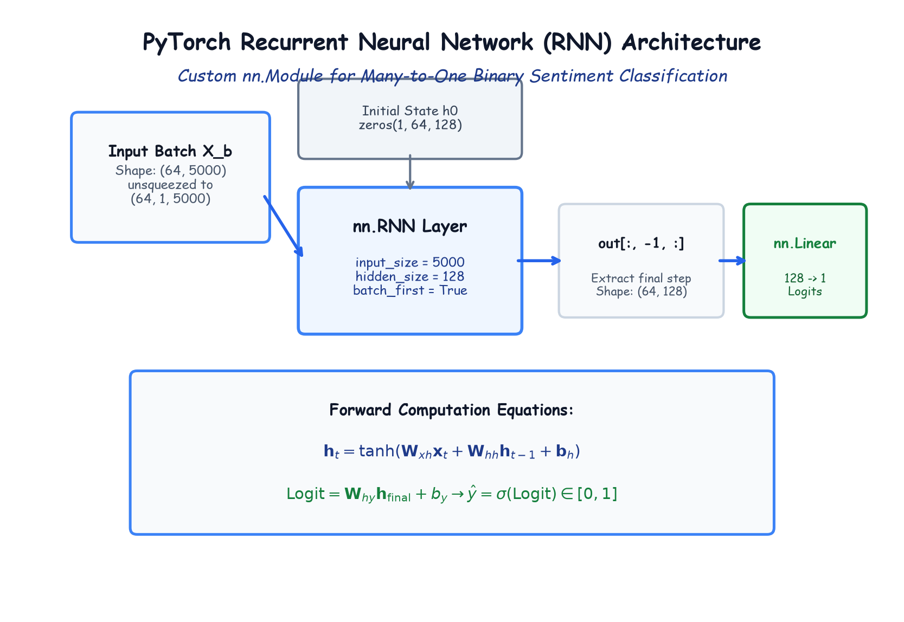

# Module 41.07 (Hinglish): Designing the Recurrent Neural Network (RNN) Architecture in PyTorch

## 1. PyTorch me RNN Architecture ka Structure

Sentiment analysis ke liye hum PyTorch ka `nn.Module` use karke custom RNN class banate hain.

Normal Neural Networks me input fixed 2D vector hota hai, lekin PyTorch ka `nn.RNN` sequential data expect karta hai jisme 3 dimensions hoti hain:
$$\mathbf{X} \in \mathbb{R}^{(\text{Batch Size}, \text{Sequence Length}, \text{Input Size})}$$

Humare TF-IDF vector me $5,000$ features hain. Hum isko sequence length $T=1$ ke roop me treat karte hain:
$$(64, 5000) \xrightarrow{\text{unsqueeze(1)}} (64, 1, 5000)$$

---

## 2. Notebook-Friendly Hand-Drawn Architecture Diagram



*Figure 41.07: PyTorch RNN model ka complete forward flow: 3D unsqueezed tensor, zero-initialized hidden state $h_0$, recurrent memory layer, final timestep extraction, aur single-node Linear readout head.*

---

## 3. PyTorch Model Code

```python
import torch
import torch.nn as nn

class RNN(nn.Module):
    def __init__(self, input_size, hidden_size=128, num_layers=1):
        super().__init__()

        self.hidden_size = hidden_size
        self.num_layers = num_layers

        # 1. RNN Layer
        self.rnn = nn.RNN(input_size, hidden_size, num_layers, batch_first=True)

        # 2. Linear Readout Layer
        self.fc = nn.Linear(hidden_size, 1)

    def forward(self, x):
        # Initial hidden state h0 = 0
        h0 = torch.zeros(self.num_layers, x.size(0), self.hidden_size)

        # RNN forward pass
        out, _ = self.rnn(x, h0) 
        # out shape: (batch_size, seq_len, hidden_size)

        # Aakhiri time-step ka hidden state extract karna
        out = self.fc(out[:, -1, :]) # shape: (batch_size, 1)
        return out
```

---

## 4. Total Model Parameters ka Exact Calculation

1. **Input-to-Hidden Weights ($\mathbf{W}_{xh}$):** $128 \times 5,000 = 640,000$
2. **Hidden-to-Hidden Weights ($\mathbf{W}_{hh}$):** $128 \times 128 = 16,384$
3. **RNN Biases ($\mathbf{b}_h$):** $128$
4. **Linear Layer Weights ($\mathbf{W}_{hy}$):** $1 \times 128 = 128$
5. **Linear Bias ($b_y$):** $1$

$$\text{Total Parameters} = 640,000 + 16,384 + 128 + 128 + 1 = \mathbf{656,641} \text{ parameters}$$
