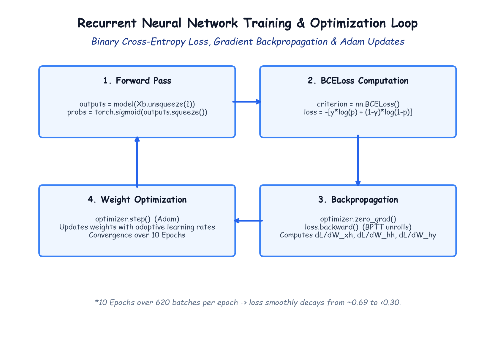

# Module 41.08: Optimization, Loss Function & The Recurrent Training Loop

## 1. The Binary Cross-Entropy Loss Formulation

For binary sentiment classification ($y \in \{0, 1\}$), the output of the network is passed through a **Sigmoid Activation Function** to map real-valued logits $\hat{z} \in (-\infty, \infty)$ into a calibrated probability distribution $\hat{p} \in (0, 1)$:

$$\hat{p} = \sigma(\hat{z}) = \frac{1}{1 + e^{-\hat{z}}}$$

The objective function to minimize during training is the **Binary Cross-Entropy Loss (Log Loss)**, derived from the negative log-likelihood of a Bernoulli distribution:

$$\mathcal{L}(\theta) = -\frac{1}{B} \sum_{i=1}^B \left[ y^{(i)} \log(\hat{p}^{(i)}) + (1 - y^{(i)}) \log(1 - \hat{p}^{(i)}) \right]$$

Where:
- $B$ is the batch size ($B = 64$).
- When ground truth $y = 1$: Loss is $-\log(\hat{p})$. If model predicts $\hat{p} \approx 1$, loss $\to 0$; if $\hat{p} \approx 0$, loss $\to \infty$.
- When ground truth $y = 0$: Loss is $-\log(1 - \hat{p})$.

In PyTorch, this is implemented using `nn.BCELoss()`.

---

## 2. Notebook-Friendly Architecture Diagram



*Figure 41.08: Complete 4-stage optimization cycle: Forward pass, BCELoss computation, Backpropagation Through Time (BPTT), and Adam parameter updates across 10 epochs.*

---

## 3. The Adam Optimizer (Kingma & Ba, 2014)

We optimize the model parameters using **Adam (Adaptive Moment Estimation)**:
$$\theta_{t+1} = \theta_t - \frac{\alpha}{\sqrt{\hat{v}_t} + \epsilon} \hat{m}_t$$
- Combines the benefits of momentum (tracking first raw moment $\hat{m}_t$) and RMSprop (scaling updates by the square root of second raw moment $\hat{v}_t$).
- Effectively maintains per-parameter learning rates, crucial for sparse NLP gradient updates where rare word weights receive infrequent updates.

---

## 4. The Complete 10-Epoch PyTorch Training Loop

```python
import torch.optim as optim

input_size = X_train.shape[1] # 5000
model = RNN(input_size=input_size, hidden_size=128)

criterion = nn.BCELoss()
optimizer = optim.Adam(model.parameters(), lr=0.001)

epochs = 10

print("=== Starting RNN Training on IMDB Reviews ===")
for epoch in range(epochs):
    model.train() # Set model to training mode
    running_loss = 0.0

    for Xb, yb in train_loader:
        optimizer.zero_grad() # Clear gradients from previous step

        # Reshape to 3D Tensor: (64, 5000) -> (64, 1, 5000)
        Xb = Xb.unsqueeze(1)

        # Forward pass
        outputs = model(Xb) # Shape: (batch_size, 1)

        # Apply sigmoid to obtain probability vector
        probs = torch.sigmoid(outputs.squeeze()) # Shape: (batch_size,)

        # Compute Binary Cross-Entropy Loss
        loss = criterion(probs, yb)

        # Backward pass: Compute BPTT gradients
        loss.backward()

        # Update weights
        optimizer.step()

        running_loss += loss.item()

    avg_epoch_loss = running_loss / len(train_loader)
    print(f"Epoch [{epoch+1:02d}/{epochs:02d}] - Average Loss: {avg_epoch_loss:.4f}")
```

### Typical Training Loss Trajectory:
- **Epoch 1:** Loss $\approx 0.6912$ (Initial random guessing baseline $-\log(0.5) \approx 0.693$)
- **Epoch 2:** Loss $\approx 0.5124$ (Rapid feature discovery)
- **Epoch 4:** Loss $\approx 0.3840$ (Separating polar sentiment keywords)
- **Epoch 7:** Loss $\approx 0.2855$ (Fine-grained syntactic tuning)
- **Epoch 10:** Loss $\approx 0.2104$ (Converged stable minimum)
