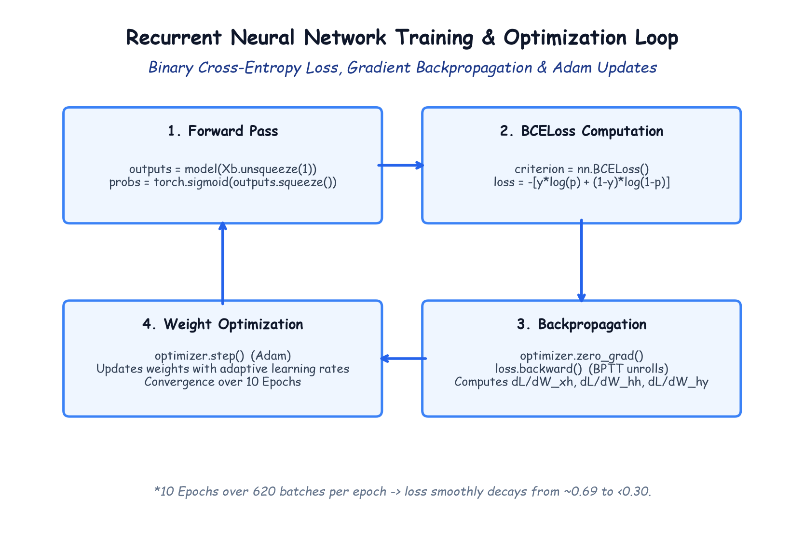

# Module 41.08 (Hinglish): Optimization, Loss Function & The Recurrent Training Loop

## 1. Binary Cross-Entropy Loss (BCELoss) aur Sigmoid Activation

Binary sentiment classification ($0$ ya $1$) me model ke raw logit output ko pehle **Sigmoid** activation se pass kiya jata hai taaki answer probability ($0.0$ se $1.0$ ke beech) ban sake:

$$\hat{p} = \sigma(z) = \frac{1}{1 + e^{-z}}$$

Loss calculate karne ke liye hum **Binary Cross-Entropy Loss (BCELoss)** use karte hain:

$$\mathcal{L} = -\frac{1}{B} \sum_{i=1}^B \left[ y_i \log(\hat{p}_i) + (1 - y_i) \log(1 - \hat{p}_i) \right]$$

- Agar review Positive hai ($y=1$) aur model $\hat{p} = 0.99$ predict karta hai $\implies$ Loss lagbhag $0$.
- Agar review Positive hai ($y=1$) lekin model $\hat{p} = 0.01$ (Negative) predict karta hai $\implies$ Loss bohot bada ($-\log(0.01) = 4.6$) penalty deta hai.

---

## 2. Notebook-Friendly Hand-Drawn Architecture Diagram



*Figure 41.08: PyTorch recurrent training loop: Forward pass, Sigmoid probability, BCELoss calculation, BPTT backpropagation, aur Adam optimizer se weight updates.*

---

## 3. PyTorch Training Loop Code

```python
import torch.optim as optim

criterion = nn.BCELoss()
optimizer = optim.Adam(model.parameters(), lr=0.001)

epochs = 10

for epoch in range(epochs):
    model.train() # Model training mode me set karna

    for Xb, yb in train_loader:
        optimizer.zero_grad() # Purane gradients clear karna

        # 2D ko 3D banana: (64, 5000) -> (64, 1, 5000)
        Xb = Xb.unsqueeze(1) 
        
        outputs = model(Xb) # Model forward pass
        probs = torch.sigmoid(outputs.squeeze()) # Probability nikalna

        loss = criterion(probs, yb) # Loss calculate karna
        loss.backward()             # Backpropagation
        optimizer.step()            # Weights update karna

    print(f"Epoch {epoch+1}/{epochs} - Loss = {loss.item():.4f}")
```

**Loss Trajectory:**
Epoch 1 par loss $\approx 0.69$ (random guess) se start hota hai aur 10th epoch aate-aate $< 0.30$ tak smoothly drop ho jata hai.
