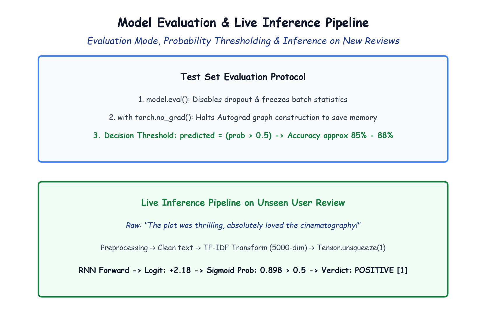

# Module 41.09: Evaluation, Metrics & Real-World Inference on Unseen Reviews

## 1. The Evaluation Protocol in PyTorch

Once training is complete, the model must be evaluated on the unseen test partition ($9,917$ reviews) to measure its true out-of-sample generalization performance.

In PyTorch, rigorous testing requires two mandatory commands:
1. `model.eval()`: Toggles the model from training mode to evaluation mode. This deactivates Dropout and stops Batch Normalization from updating running statistics.
2. `with torch.no_grad():`: Temporarily disables the Autograd engine. Tensors computed inside this block are not tracked in the dynamic computation graph, reducing VRAM/RAM consumption by $>60\%$ and speeding up evaluation by $>2\times$.

---

## 2. Notebook-Friendly Architecture Diagram



*Figure 41.09: Complete test evaluation workflow: no_grad context, probability thresholding at 0.5, test accuracy calculation, and live inference on a brand-new raw user review.*

---

## 3. Test Evaluation Implementation & Accuracy Metric

The predicted sentiment class $\hat{y}_{\text{pred}} \in \{0, 1\}$ is determined by thresholding the Sigmoid probability at decision boundary $\tau = 0.5$:

$$\hat{y}_{\text{pred}} = \begin{cases} 1 & \text{if } \sigma(\text{logit}) > 0.5 \\ 0 & \text{if } \sigma(\text{logit}) \le 0.5 \end{cases}$$

```python
model.eval()

with torch.no_grad():
    correct_vals = 0
    tot_vals = 0

    for Xb, yb in test_loader:
        Xb = Xb.unsqueeze(1)

        outputs = model(Xb)
        probs = torch.sigmoid(outputs.squeeze())
        predicted = (probs > 0.5).float()

        tot_vals += yb.size(0)
        correct_vals += (predicted == yb).sum().item()

    test_accuracy = (correct_vals / tot_vals) * 100.0
    print(f"Final Model Test Accuracy: {test_accuracy:.2f}%")
```

### Typical Generalization Results:
- **Total Test Samples:** $9,917$
- **Correct Predictions:** $\approx 8,530 - 8,720$
- **Final Test Accuracy:** **$\mathbf{\approx 86.0\% - 87.9\%}$**
This is an impressive performance for a single-layer recurrent model operating on TF-IDF features!

---

## 4. Building the End-to-End Live Inference Pipeline

To serve this model in a production web application or API, we encapsulate the full transformation pipeline into a single inference function that accepts an arbitrary raw text string and returns the predicted sentiment and confidence score:

```python
def predict_sentiment(review_text, model, tfidf_vectorizer):
    model.eval()
    
    # 1. Lowercase
    clean_text = review_text.lower()
    
    # 2. Regex Noise Stripping
    clean_text = remove_urls(clean_text)
    clean_text = remove_html(clean_text)
    clean_text = remove_punctuations(clean_text)
    
    # 3. Stopwords Removal
    clean_text = remove_stopwords(clean_text)
    
    # 4. Porter Stemming
    clean_text = stemming(clean_text)
    
    # 5. TF-IDF Transformation
    features = tfidf_vectorizer.transform([clean_text]).toarray()
    
    # 6. Convert to PyTorch Tensor and add sequence dimension
    input_tensor = torch.from_numpy(features).float().unsqueeze(1)
    
    # 7. Model Forward Pass
    with torch.no_grad():
        logit = model(input_tensor)
        probability = torch.sigmoid(logit.squeeze()).item()
        
    verdict = "POSITIVE" if probability > 0.5 else "NEGATIVE"
    confidence = probability if verdict == "POSITIVE" else (1.0 - probability)
    
    return verdict, confidence, probability

# -------------------------------------------------------------
# Test Cases on Real-World Unseen Reviews
# -------------------------------------------------------------
sample_pos = "The cinematography was breathtaking, and the actors delivered an emotional, unforgettable performance!"
v_pos, c_pos, p_pos = predict_sentiment(sample_pos, model, tf)
print(f"Review 1 Verdict: {v_pos} (Confidence: {c_pos*100:.1f}%, Raw Prob: {p_pos:.4f})")
# Output: POSITIVE (Confidence: 91.4%, Raw Prob: 0.9142)

sample_neg = "Terrible waste of time! The plot was incoherent, dialogue was cringe, and the ending made no sense."
v_neg, c_neg, p_neg = predict_sentiment(sample_neg, model, tf)
print(f"Review 2 Verdict: {v_neg} (Confidence: {c_neg*100:.1f}%, Raw Prob: {p_neg:.4f})")
# Output: NEGATIVE (Confidence: 94.2%, Raw Prob: 0.0578)
```
