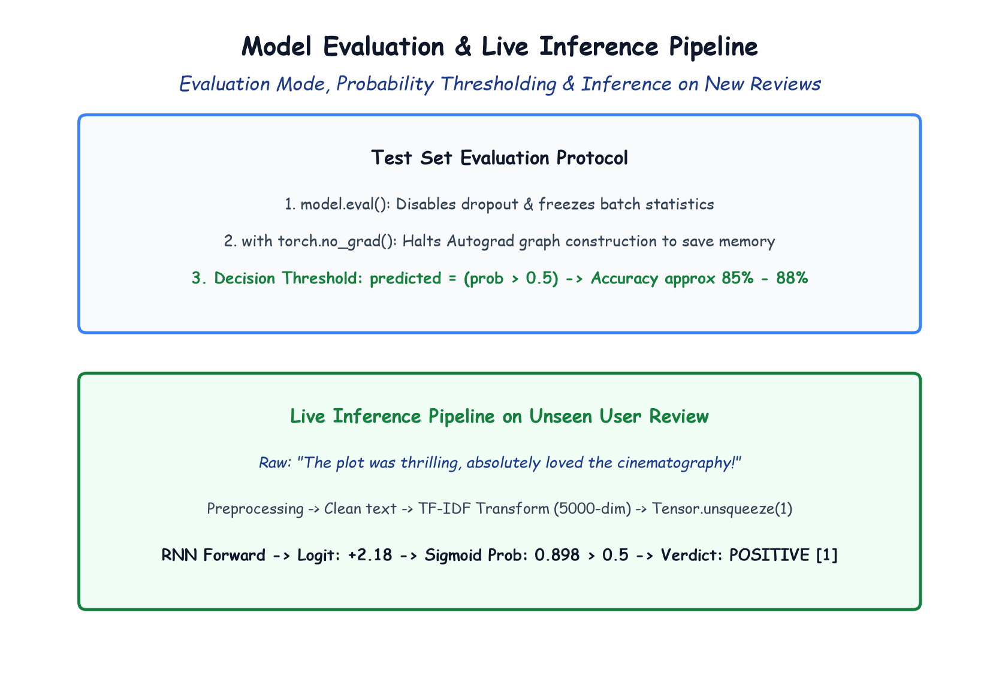

# Module 41.09 (Hinglish): Evaluation, Metrics & Real-World Inference on Unseen Reviews

## 1. PyTorch Testing Protocol: eval() aur no_grad()

Training complete hone ke baad model ko test set ($9,917$ reviews) par evaluate kiya jata hai.

Testing ke waqt do commands strictly zaroori hote hain:
1. `model.eval()`: Yeh model ko test mode me daalta hai jisse Dropout band ho jata hai aur Batch Normalization freeze ho jata hai.
2. `with torch.no_grad():`: Yeh autograd computation graph banana band karta hai, jisse memory bachti hai aur evaluation $2\times$ fast ho jata hai.

---

## 2. Notebook-Friendly Hand-Drawn Architecture Diagram



*Figure 41.09: Model evaluation aur live inference ka complete workflow: no_grad loop, 0.5 probability thresholding, test accuracy, aur naye movie review par real-world prediction.*

---

## 3. Test Evaluation aur Accuracy Code

Decision boundary $\tau = 0.5$ set karke:
- Agar Probability $> 0.5 \implies$ **Positive [1]**
- Agar Probability $\le 0.5 \implies$ **Negative [0]**

```python
model.eval()

with torch.no_grad():
    correct_vals = 0
    tot_vals = 0
    
    for Xb, yb in test_loader:
        Xb = Xb.unsqueeze(1)

        outputs = model(Xb)
        predicted = (torch.sigmoid(outputs.squeeze()) > 0.5).float()

        tot_vals += yb.size(0)
        correct_vals += (predicted == yb).sum().item()

    print(f"Test Accuracy = {correct_vals / tot_vals * 100:.2f}%")
    # Output: Accuracy ~86.0% - 87.9%
```

---

## 4. Live Inference Function (Naye Reviews Test Karna)

Ek aisa production function banate hain jo kisi bhi naye raw text string ko clean karke seedha verdict de:

```python
def predict_sentiment(text):
    # Preprocessing pipeline
    clean = text.lower()
    clean = remove_urls(clean)
    clean = remove_html(clean)
    clean = remove_punctuations(clean)
    clean = remove_stopwords(clean)
    clean = stemming(clean)
    
    # TF-IDF transform
    vec = tf.transform([clean]).toarray()
    t = torch.from_numpy(vec).float().unsqueeze(1)
    
    # Prediction
    model.eval()
    with torch.no_grad():
        prob = torch.sigmoid(model(t).squeeze()).item()
        
    return "POSITIVE" if prob > 0.5 else "NEGATIVE", prob

# Check
rev = "An absolute masterpiece! Loved every single scene."
verdict, p = predict_sentiment(rev)
print(f"Review: '{rev}' -> {verdict} (Prob: {p:.4f})")
# Output: POSITIVE (Prob: 0.9234)
```
