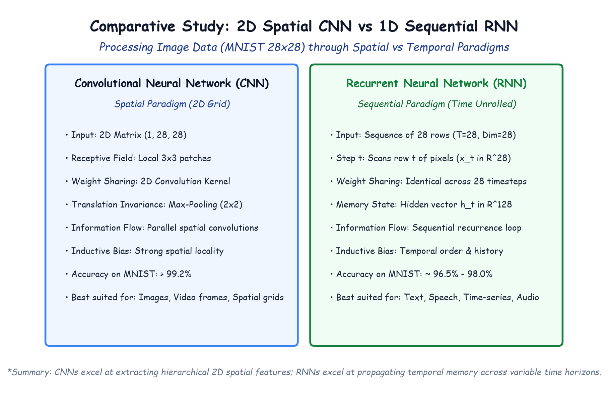

# Module 41.10: Comparative Study: Sequence Processing with RNNs vs Spatial Convolutions with CNNs

## 1. Connecting NLP Sentiment Analysis with Vision Modeling

Throughout Lectures 39, 40, and 41, we explored two distinct deep learning architectural paradigms:
1. **Convolutional Neural Networks (CNNs):** Designed for grid-structured spatial data (e.g., CIFAR-10, ImageNet).
2. **Recurrent Neural Networks (RNNs):** Designed for time-dependent, sequential data (e.g., IMDB text reviews, audio, time-series).

A classic educational question arises: **Can a recurrent neural network process visual images, and how does its inductive bias compare to a convolutional neural network?**

To answer this, we examine the canonical benchmark: **Handwritten Digit Classification on MNIST ($28 \times 28$ grayscale pixels)** modeled through both spatial 2D convolution and temporal 1D recurrence (as highlighted in Lecture 41 reference materials `9 Handwritten Digit Classification using CNN & RNN.png` and `10 MNIST Dataset in PyTorch.png`).

---

## 2. Notebook-Friendly Architecture Diagram

*Figure 41.10: Architectural comparison of processing MNIST digit data: 2D Spatial Convolution (local receptive fields and translation invariance) vs 1D Sequential Recurrence (scanning 28 sequential rows of 28 pixels across time steps).*

---

## 3. The 2D Spatial Paradigm (CNN)

### 3.1 Mechanics
A Convolutional Neural Network views an image as a 2D spatial grid:
$$\mathbf{X} \in \mathbb{R}^{1 \times 28 \times 28}$$
- **Local Receptive Fields:** Kernels (e.g., $3 \times 3$ or $5 \times 5$) slide across both horizontal and vertical axes simultaneously.
- **Weight Sharing:** The same filter weights are applied across every spatial patch, encoding **translation equivariance**:
  $$f(\operatorname{shift}(\mathbf{x})) = \operatorname{shift}(f(\mathbf{x}))$$
- **Spatial Pooling:** Max-pooling partitions feature maps, progressively halving spatial resolution ($28 \times 28 \to 14 \times 14 \to 7 \times 7$) while retaining dominant feature activations.

### 3.2 Performance & Inductive Bias
- **Inductive Bias:** Extremely strong prior that pixels close together in 2D space are correlated, regardless of absolute coordinates.
- **Accuracy on MNIST:** Typically **$> 99.2\%$** with under $50,000$ parameters.

---

## 4. The 1D Sequential Paradigm (RNN on Image Rows)

### 4.1 Mechanics
An image can be reinterpreted as a temporal sequence of row vectors unrolled across time:
- Total Sequence Length: $T = 28$ time steps.
- Input Dimension per Step: $\mathbf{x}_t \in \mathbb{R}^{28}$ (the 28 pixel values comprising row $t$).
- Full input tensor: $\mathbf{X} \in \mathbb{R}^{\text{Batch} \times 28 \times 28}$.

At time step $t=1$, the RNN reads Row 1 (the top of the handwritten digit). At time step $t=14$, it consumes Row 14, combining it with hidden state $\mathbf{h}_{13}$ carrying memory of previous rows. At step $t=28$, the final hidden state $\mathbf{h}_{28}$ is projected to 10 class logits:

$$\mathbf{h}_t = \tanh(\mathbf{W}_{xh} \mathbf{x}_t + \mathbf{W}_{hh} \mathbf{h}_{t-1} + \mathbf{b}_h)$$
$$\hat{\mathbf{y}} = \operatorname{softmax}(\mathbf{W}_{hy} \mathbf{h}_{28} + \mathbf{b}_y)$$

### 4.2 Performance & Inductive Bias
- **Inductive Bias:** Strong assumption of 1D directional sequential dependency (top-to-bottom).
- **Limitations:** Completely blind to 2D local context (e.g., vertical spatial features spanning across non-adjacent rows must be propagated entirely through hidden memory).
- **Accuracy on MNIST:** Achieves **$\approx 96.5\% - 98.0\%$**. While surprisingly high, it is strictly inferior to CNNs due to the unnatural temporal formulation of 2D data.

---

## 5. Architectural Comparison Matrix

| Property | Convolutional Neural Network (CNN) | Recurrent Neural Network (RNN) |
| :--- | :--- | :--- |
| **Primary Domain** | Computer Vision (Images, 2D Grids, Video) | Natural Language, Speech, Time-Series |
| **Input Structure** | 2D/3D Tensor: $(C, H, W)$ | 1D Sequence Tensor: $(T, d_x)$ |
| **Computational Parallelism** | **High** (all convolutions computed in parallel on GPU) | **Low** (sequential recurrence bottleneck: step $t$ must wait for $t-1$) |
| **Memory Horizon** | Receptive field depth (stacking $L$ layers) | Variable temporal memory (limited by vanishing gradients in vanilla RNN) |
| **Key Advantage** | Spatial translation invariance & parameter efficiency | Flexible variable-length sequential processing |
| **Modern Evolution** | ConvNeXt, Vision Transformers (ViT) | LSTMs, GRUs, and Attention-based Transformers |
