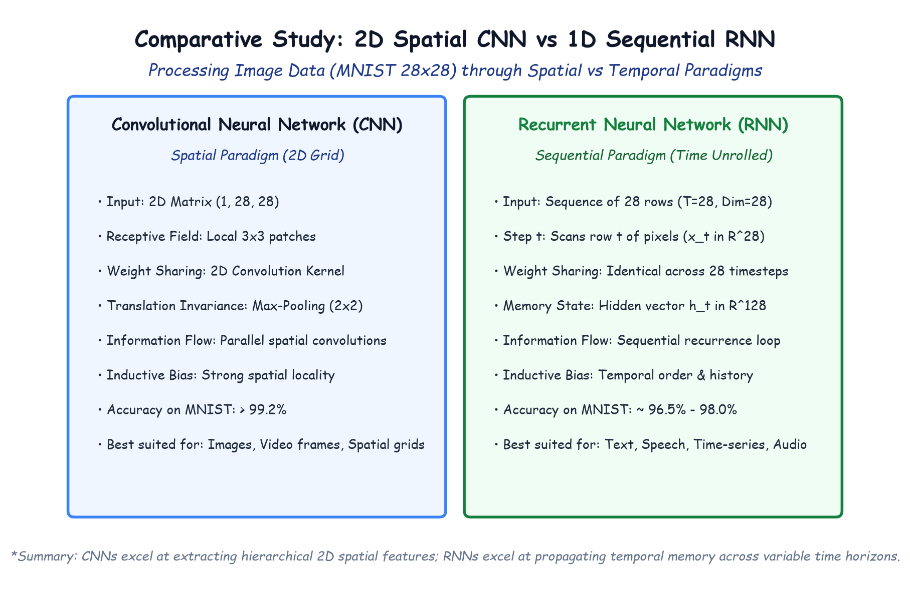

# Module 41.10 (Hinglish): Comparative Study: Sequence Processing with RNNs vs Spatial Convolutions with CNNs

## 1. CNN aur RNN ka Comparison

Deep Learning me do major neural network families hoti hain:
1. **Convolutional Neural Networks (CNN):** Spatial data (Images, Grid data) ke liye best hote hain.
2. **Recurrent Neural Networks (RNN):** Temporal data (Text, Audio, Sequences) ke liye best hote hain.

Lekin kya ek RNN image classification kar sakta hai?
Haan! **MNIST Handwritten Digit Dataset ($28 \times 28$)** ko hum dono models se process karke compare kar sakte hain (jaise Day 41 reference image `9 Handwritten Digit Classification using CNN & RNN.png` me show kiya gaya hai).

---

## 2. Notebook-Friendly Hand-Drawn Architecture Diagram

*Figure 41.10: MNIST dataset par 2D Spatial Convolution vs 1D Sequential Recurrence ka clear visual comparison: CNN 2D grid patches scan karta hai jabki RNN 28 rows ko 28 time steps ki tarah scan karta hai.*

---

## 3. Image ko Process Karne ke Do Alag Tareeqe

### Tareeqa 1: CNN (2D Spatial Convolutions)
- Image ko ek 2D surface maanta hai ($(1, 28, 28)$).
- Chhote filters ($3 \times 3$) horizontal aur vertical dono directions me ek sath move karte hain.
- **Translation Invariance:** Digit thoda left ya right shift ho jaye, CNN fir bhi use easily pehchan leta hai.
- **Accuracy:** $> 99.2\%$.

### Tareeqa 2: RNN (1D Row-by-Row Sequence)
- Image ko 28 time-steps ka ek sequence bana diya jata hai ($T=28$).
- Step $t=1$ par Row 1 ($28$ pixels) input hoti hai.
- Step $t=2$ par Row 2 input hoti hai aur pichli row ki memory $\mathbf{h}_1$ use hoti hai.
- Aakhiri step $t=28$ par final hidden state $\mathbf{h}_{28}$ se digit class (0 se 9) predict hoti hai.
- **Accuracy:** $\approx 96.5\% - 98.0\%$.

---

## 4. Key Differences Table

| Feature | CNN | RNN |
| :--- | :--- | :--- |
| **Input Type** | 2D Spatial Grid $(C, H, W)$ | 1D Time Sequence $(T, \text{dim})$ |
| **GPU Parallelism** | **Bohot High** (Saare patches ek sath compute hote hain) | **Low** (Step $t$ ko step $t-1$ ka wait karna padta hai) |
| **Best suited for** | Computer Vision (Images, Video frames) | Natural Language (Text, Speech, Audio) |
| **MNIST Performance** | **$> 99.2\%$** | **$\approx 97\%$** |
